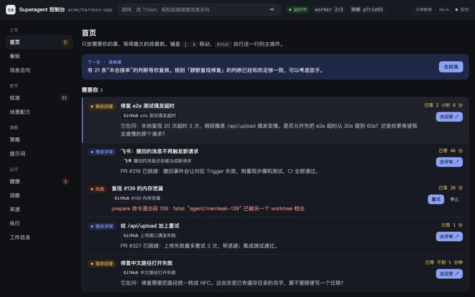

[中文](README.md) | English

# dsh-superagent-ui

A local console for the operator of [dsh-superagent](https://github.com/deepseek-ai/dsh-superagent-prototype). Team members keep finding the agent in GitHub or Feishu; here you handle what needs you, check that it is healthy, and gradually let it take on work by itself.



> This is a community project, not an official DeepSeek product. dsh-superagent itself is a research prototype; read the [security notes](#security) below before using it.

The console UI is in Chinese only. The docs are available in English and Chinese.

## Features

| Group | Pages | Used for |
| --- | --- | --- |
| Work | Home, Board, Message path | Handle what is waiting on you, follow each Ticket's history, find where a message went |
| Let go | Calibration, Recipes | Review its judgments, then decide what it may do on its own |
| Tune | Policy, Prompts | Decide who can give it work and how it works |
| Run | Health, Insights, Sources, Execution, Directories | See status, models and disk usage; configure sources |

Press ⌘K or `/` to open the command palette.

## Install

Copy one of the prompts below to your coding agent (DSH, Claude Code, Codex, or anything else that can run commands). It follows the install guide in the repository step by step, and stops to hand things like signing in or entering keys over to you.

You can also do it without an agent: follow the guides in [`docs/install/`](docs/install) yourself.

### See it first (sample data)

Only needs Node.js 24+ and pnpm, and connects to no external service.

```text
Help me preview dsh-superagent-ui.
If ~/src/dsh-superagent-ui does not exist, first run:
git clone --recurse-submodules https://github.com/hustnn/dsh-superagent-ui.git ~/src/dsh-superagent-ui
Then read ~/src/dsh-superagent-ui/docs/install/preview.en.md and follow its rules and steps exactly.
```

### Connect GitHub (minimal install)

Installs dsh-superagent and the console, so the agent takes work in a GitHub repository you choose.

```text
Help me install dsh-superagent-ui with GitHub.
If ~/src/dsh-superagent-ui does not exist, first run:
git clone --recurse-submodules https://github.com/hustnn/dsh-superagent-ui.git ~/src/dsh-superagent-ui
Then read ~/src/dsh-superagent-ui/docs/install/core.en.md and follow its rules and steps exactly.
When something needs me to do it, tell me exactly what to do and wait for my confirmation before continuing. Never ask me for passwords, tokens or API keys in the conversation.
```

### Add Feishu (optional)

Do this after the GitHub install.

```text
Add the Feishu source to my existing dsh-superagent install.
Read ~/src/dsh-superagent-ui/docs/install/feishu.en.md and follow its rules and steps exactly.
When something needs me to do it, tell me exactly what to do and wait for my confirmation before continuing. Never ask me for passwords, tokens or API keys in the conversation.
```

### Requirements

| Install | Needs |
| --- | --- |
| Sample-data preview | Node.js 24+, pnpm |
| GitHub | The above, plus git, Python 3, tmux, `gh`, `jq`, DSH; an API key for a model; a GitHub repository; **a GitHub account for the agent** |
| Feishu | All of the above, plus `lark-cli` and a custom Feishu app |

- **GitHub is the minimal requirement.** GitHub alone is enough to run everything; Feishu is an optional extra source. The reverse doesn't work: dsh-superagent checks the GitHub repository and push access on start, so it is needed even when you only use Feishu.
- **The agent needs its own GitHub account.** dsh-superagent ignores Issues and comments posted by the agent's own account. If it uses your account, @ mentioning it on GitHub gets no response.

### What has been tested

- **Platforms:** tested on macOS. Linux hasn't been tested yet. Windows isn't supported, because the service scripts depend on tmux.
- **Feishu + GitHub:** the full flow from a Feishu request to an opened PR has been run.
- **GitHub only:** verified in a clean environment through to a finished configuration and a working console. That run used a stubbed `gh`, so the part from @ mentioning the agent in an Issue to an opened PR hasn't been run with a separate agent account yet.

## Security

- **Workers have broad access.** They run as your system user with `danger-full-access` and can read your home directory. The account wrappers only choose which identity it uses by default; they are not isolation. For isolation, use a separate system account that only holds the agent's credentials.
- **Start small.** Use a sandbox repository first, keep only yourself on the allow list, and leave proactive work in the default "observe" mode.
- **The console is local only.** The BFF binds to `127.0.0.1` and needs the startup token to open. Don't share links that contain the token.

## Docs

- [Operations](docs/operations.en.md): start and stop, update, upgrade, environment variables, the companion plugin, troubleshooting
- [Design](docs/design.en.md): why it is designed this way, the six loops, pages and roadmap
- [Architecture](docs/architecture.en.md): BFF, security model, risk levels, live updates

## Development

```bash
pnpm install
pnpm dev:mock   # develop with sample data, reloads on change
pnpm dev        # connect to the dsh-superagent running on this machine
pnpm check      # typecheck + tests + build
```

```text
apps/bff           Local BFF: the only way in to dsh-superagent (Hono; Node runs the TypeScript directly)
apps/console       Web console (React + Vite)
packages/contract  The BFF's API types, shared by the BFF and the console
packages/companion A DSH plugin installed next to dsh-superagent: worker records, sent messages, switching the main Session's model
upstream/          dsh-superagent (submodule, read-only, for checking API types)
patches/           Patches applied when deploying dsh-superagent
docs/              Install guides, operations, design and architecture
```

The console only reads and writes through dsh-superagent's admin API (`/orchestrator/api`) and doesn't depend on its internals. The BFF hand-copies part of that API's types (`apps/bff/src/upstream/types.ts`) to match `upstream/`'s current commit; check them again when moving the submodule.

## License

[MIT](LICENSE). dsh-superagent is released under the MIT license by the DeepSeek Harness Team; the contents of `upstream/` and `patches/` come from or target that project.
