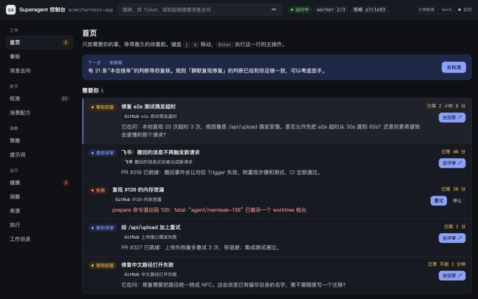

中文 | [English](README.en.md)

# dsh-superagent-ui

给 [dsh-superagent](https://github.com/deepseek-ai/dsh-superagent-prototype) 的 operator 用的本地控制台。团队成员照旧在 GitHub 或飞书里找 agent；你在这里处理需要你的事，看它是否健康，再逐步放手让它主动干活。



> 这是社区项目，不是 DeepSeek 的官方产品。dsh-superagent 本身也是研究原型，使用前请看下面的[安全提示](#安全提示)。

## 功能

| 分组 | 页面 | 用来 |
| --- | --- | --- |
| 工作 | 首页、看板、消息去向 | 处理等你的事，看每个 Ticket 的经过，查一条消息去了哪里 |
| 放手 | 校准、场景配方 | 复核它的判断，再决定让它主动做哪些事 |
| 调教 | 策略、提示词 | 决定谁能让它干活，以及它怎么干 |
| 运行 | 健康、洞察、来源、执行、工作目录 | 看运行状态、模型和磁盘占用，配置来源 |

按 ⌘K 或 `/` 打开命令面板。

## 安装

把下面的提示词复制给你的 coding agent（DSH、Claude Code、Codex 等能运行命令的都可以）。它会按仓库里的安装指南逐步执行；登录账号、填写密钥这类事会停下来交给你。

不用 agent 也可以：[`docs/install/`](docs/install) 里的指南可以自己照着做。

### 先看效果（示例数据）

只需要 Node.js 24+ 和 pnpm，不连接任何外部服务。

```text
帮我预览 dsh-superagent-ui。
如果 ~/src/dsh-superagent-ui 不存在，先运行：
git clone --recurse-submodules https://github.com/hustnn/dsh-superagent-ui.git ~/src/dsh-superagent-ui
然后读取 ~/src/dsh-superagent-ui/docs/install/preview.md，严格按里面的规则和步骤执行。
```

### 接入 GitHub（最小可用安装）

会安装 dsh-superagent 和控制台，让 agent 在你指定的 GitHub 仓库里接活。

```text
帮我安装 dsh-superagent-ui，接入 GitHub。
如果 ~/src/dsh-superagent-ui 不存在，先运行：
git clone --recurse-submodules https://github.com/hustnn/dsh-superagent-ui.git ~/src/dsh-superagent-ui
然后读取 ~/src/dsh-superagent-ui/docs/install/core.md，严格按里面的规则和步骤执行。
需要我本人操作时，告诉我具体做什么，等我确认后再继续。不要在对话里向我要密码、token 或 API key。
```

### 加上飞书（可选）

在 GitHub 安装完成之后再做。

```text
给我已经装好的 dsh-superagent 加上飞书来源。
读取 ~/src/dsh-superagent-ui/docs/install/feishu.md，严格按里面的规则和步骤执行。
需要我本人操作时，告诉我具体做什么，等我确认后再继续。不要在对话里向我要密码、token 或 API key。
```

### 依赖

| 安装内容 | 需要 |
| --- | --- |
| 示例数据预览 | Node.js 24+、pnpm |
| GitHub | 上面两项，加 git、Python 3、tmux、`gh`、`jq`、DSH；一个模型的 API key；一个 GitHub 仓库；**一个给 agent 用的 GitHub 账号** |
| 飞书 | 上面全部，加 `lark-cli` 和一个飞书自建应用 |

- **GitHub 是最小依赖。** 只用 GitHub 就能完整运行，飞书是可选的附加来源。反过来不行：dsh-superagent 启动时会检查 GitHub 仓库和推送权限，只用飞书也要配。
- **agent 要有自己的 GitHub 账号。** dsh-superagent 会忽略 agent 账号自己发的 Issue 和评论。如果它用你本人的账号，你在 GitHub 上 @ 它不会有反应。

### 测试情况

- **平台：** 在 macOS 上测过。Linux 还没有测过。Windows 不支持，因为服务脚本依赖 tmux。
- **飞书 + GitHub：** 从飞书请求到开 PR 的完整流程跑通过。
- **只用 GitHub：** 在干净环境里验证到配置完成、控制台可用。这次验证用了模拟的 `gh`，所以从 Issue 里 @ agent 到开 PR 这一段，还没有用独立的 agent 账号实跑。

## 安全提示

- **worker 权限很大。** worker 以你的系统用户身份运行，权限是 `danger-full-access`，能读你的 home 目录。账号 wrapper 只决定它默认用哪个身份，不是隔离手段。要隔离，请用一个只放 agent 凭据的独立系统账号。
- **从小范围开始。** 先用沙盒仓库，名单里只放你自己，主动接单保持默认的“观察”。
- **控制台只在本机访问。** BFF 只绑定 `127.0.0.1`，打开时要用启动 token。不要把带 token 的链接发给别人。

## 文档

- [日常运行](docs/operations.md)：启停、更新、升级、环境变量、companion 插件、常见问题
- [设计](docs/design.md)：为什么这样设计、六个价值闭环、页面与路线图
- [架构](docs/architecture.md)：BFF、安全模型、风险分级、实时更新

## 开发

```bash
pnpm install
pnpm dev:mock   # 用示例数据开发，改了自动刷新
pnpm dev        # 接本机正在运行的 dsh-superagent
pnpm check      # 类型检查 + 测试 + 构建
```

```text
apps/bff           本地 BFF：唯一能访问 dsh-superagent 的入口（Hono，Node 直接运行 TypeScript）
apps/console       Web 控制台（React + Vite）
packages/contract  BFF 的 API 类型，BFF 和控制台共用
packages/companion 装在 dsh-superagent 旁边的 DSH 插件：worker 的记录、发出的消息、切换主 Session 的模型
upstream/          dsh-superagent（submodule，只读，用来对照接口类型）
patches/           部署 dsh-superagent 时要打的补丁
docs/              安装指南、运行手册、设计与架构文档
```

控制台只通过 dsh-superagent 的管理 API（`/orchestrator/api`）读写，不依赖它的内部实现。BFF 手抄了这个 API 的部分类型（`apps/bff/src/upstream/types.ts`），对应 `upstream/` 当前的提交；升级 submodule 时要重新核对。

## 许可

[MIT](LICENSE)。dsh-superagent 由 DeepSeek Harness Team 以 MIT 许可发布；`upstream/` 和 `patches/` 里的内容来自或针对该项目。
